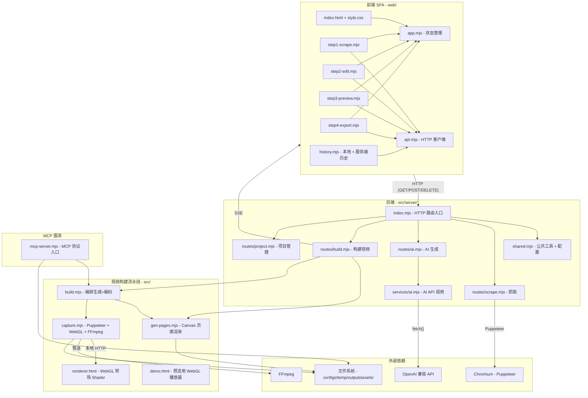
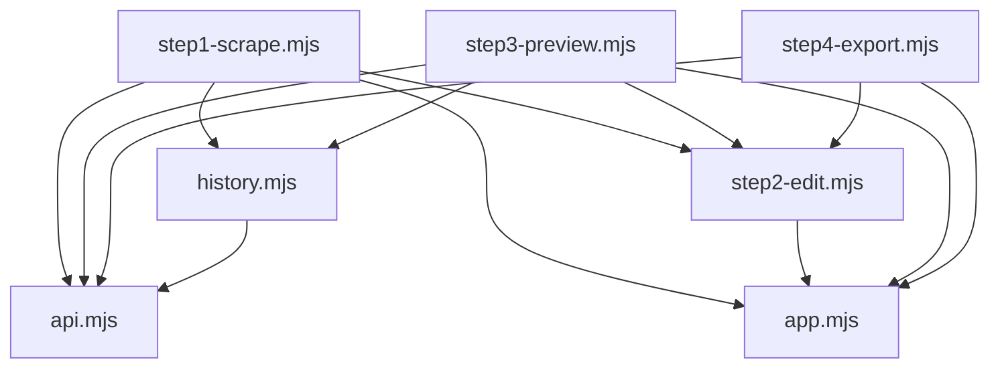

# 系统架构文档

## 1. 系统概述

**法务视频工作台（Doc Flip Video Studio）** 是一个基于浏览器的翻页动画短视频生成工具。用户输入法律文章 URL，系统自动抓取正文、调用 AI 提炼短视频脚本、生成带翻页/涂抹/淡入等 WebGL 转场动画的视频，最终导出为高清 MP4 文件。产品定位为"法律科普短视频的批量化生产工具"。

## 2. 技术栈

| 层次 | 技术 | 用途 |
|---|---|---|
| **后端运行时** | Node.js 原生 `http` 模块 | 零依赖 HTTP 服务器，无需 Express |
| **页面生成** | `node-canvas` (canvas npm 包) | 服务端渲染封面/正文 PNG，支持中文排版、渐变、条码 |
| **动画渲染** | WebGL (原生 GLSL shader) | 翻页卷角（PageCurl）、标记笔涂抹（Sweep）、纵深入场（Settle）、淡入（Blend）四种转场 |
| **视频编码** | FFmpeg (`libx264`) | 将 Puppeteer 截取的 JPEG 帧序列编码为 MP4，支持背景音乐混音 |
| **浏览器截图** | Puppeteer | 在 headless Chromium 中以 60fps 驱动 WebGL canvas 渲染，逐帧截取 JPEG |
| **前端** | 原生 ES Module + 原生 CSS | 无框架 SPA，4 步向导界面 |
| **AI 接口** | OpenAI-compatible HTTP API | 抓取后自动生成视频文案，支持对话式精调 |
| **工具脚本** | ZIP (系统 /usr/bin/zip) | 图片批量打包下载 |
| **其他 npm 依赖** | `jsbarcode` | 条码生成（CODE128，嵌入页面底部） |
| **开发工具** | `nodemon` | 热重载开发服务器 |

## 3. 架构图



## 4. 数据流

```
URL ──→ 抓取 ──→ AI 生成 ──→ 编辑 ──→ 预览 ──→ 构建视频 ──→ 导出
```

### 分步数据流

| 步骤 | 输入 | 处理 | 输出 | 接口 |
|---|---|---|---|---|
| **1. 抓取 (Scrape)** | 用户输入 URL | Puppeteer 打开页面，Readability 风格提取 `<article>` / `<p>` 正文 | `{ title, text, source, date, url }` | `POST /api/scrape` |
| **2. AI 生成 (Generate)** | 上一步的 `text` + `sourceInfo` | 调用 AI API，system prompt 指示提取封面标题、来源、段落（带高亮）、日期元信息 | `{ meta, cover, content }` 完整 JSON config | `POST /api/generate-config` |
| **2.5 AI 对话精调 (Refine)** | 用户自然语言指令 | 拼接历史对话 + system prompt，AI 返回完整 JSON 覆盖 | 更新后的 config | `POST /api/refine` |
| **2.75 保存 (Save)** | 编辑后的 config | 写入 `configs/article-NNN.json` | `{ issueNum, path }` | `POST /api/save` |
| **3. 预览 (Preview)** | config JSON | 1) 保存到 configs/；2) `gen-pages.mjs` 用 Canvas 渲染封面 + 正文 + 高亮三张 PNG；3) 返回图片路径 | `{ images: { cover, plain, hl } }` | `POST /api/preview` |
| **4. 构建视频 (Build)** | config JSON | **SSE 流式响应**: 1) 保存 config；2) `build.mjs` 编排 `gen-pages.mjs` + `capture.mjs`；3) Puppeteer 打开 renderer.html，以 60fps 循环调用 WebGL shader（settle→cover→curl→sweep→blend），逐帧截取 JPEG；4) 管道送入 FFmpeg 编码为 MP4 + 嵌入 poster 封面 + 可选 BGM | SSE 日志流，最终返回 `{ done, videoUrl }` | `POST /api/build` (SSE) |
| **5. 下载 (Download)** | 直接访问静态文件 | Range Request 支持（MP4 流式播放） | MP4 文件 | `GET /output/法务视频-NNN期.mp4` |

### AI 对话精调流程

```
用户消息 ──→ /api/refine ──→ 拼接待精调的 config + 最近 6 条对话历史 ──→ AI API
  ──→ 返回完整 JSON ──→ 前端用新字段浅合并 state.config ──→ populateForm() 刷新表单
  ──→ 自动触发 doPreview() 刷新预览
```

### SSE 构建流程

```
Frontend             Server              gen-pages.mjs       capture.mjs           FFmpeg
  │                    │                     │                   │                    │
  │ POST /api/build    │                     │                   │                    │
  │───────────────────>│                     │                   │                    │
  │                    │ 保存 config.json    │                   │                    │
  │                    │────────────────────>│                   │                    │
  │                    │                     │  render PNG      │                    │
  │                    │<────────────────────│                   │                    │
  │                    │ spawn build.mjs     │                   │                    │
  │                    │─────────────────────────────────────────────────────────────>│
  │                    │                     │                   │                    │
  │ SSE: log lines     │                     │                   │                    │
  │<═══════════════════│                     │ 启动 HTTP server  │                    │
  │    (stdout)        │                     │ 打开 renderer.html│                    │
  │                    │                     │ 截取 JPEG 帧      │                    │
  │                    │                     │───────────────────>│                    │
  │                    │                     │                   │ 管道写 stdin        │
  │                    │                     │                   │────────────────────>│
  │                    │                     │                   │                    │ 编码 MP4
  │                    │                     │                   │<────────────────────│
  │                    │                     │                   │ 嵌入 poster         │
  │ SSE: { done,  url }│                     │                   │                    │
  │<═══════════════════│                     │                   │                    │
```

## 5. 目录结构

```
page-flip-demo/
├── package.json                 # 项目配置：deps (canvas, jsbarcode, puppeteer), scripts
├── template.json                # 页面模板配置：尺寸、字体、所有元素坐标/样式参数
├── README.md                    # 项目说明
├── AGENTS.md                    # AI agent 工作指南
├── dev_docs/                    # 开发文档目录
│   ├── architecture.md          # ← 本文档
│   └── ...
├── assets/
│   ├── fonts/                   # 中文字体文件 (.ttf/.otf)，由 scripts/download-fonts.sh 下载
│   ├── music/                   # 背景音乐文件 (.mp3/.wav/.ogg)，构建时随机选取一首
│   └── qrcode.png               # 底部 QR 码占位图
├── configs/                     # 持久化配置目录
│   ├── settings.json            # AI API Key / Base URL / Model 等运行时设置
│   └── article-NNN.json         # 每期视频的完整配置（meta/cover/content），由 /api/save 写入
├── temp/                        # 临时文件目录
│   └── issue-NNN/
│       ├── cover.png            # 封面页图片
│       ├── content-plain.png    # 正文页（无高亮）
│       ├── content-hl.png       # 正文页（带高亮标记）
│       └── progress.json        # 视频构建进度（capture.mjs 运行时写入）
├── output/                      # 最终输出目录
│   └── 法务视频-NNN期.mp4       # 完整 MP4 视频文件
├── src/
│   ├── server/                  # HTTP 服务端
│   │   ├── index.mjs            # ★ 主入口：http.createServer，路由分发 + 静态文件服务
│   │   ├── shared.mjs           # 公共模块：目录常量、JSON 助手、设置加载/持久化、MIME 类型、工具函数
│   │   ├── routes/
│   │   │   ├── scrape.mjs       # POST /api/scrape — Puppeteer 抓取文章正文
│   │   │   ├── ai.mjs           # POST /api/generate-config — AI 生成视频配置
│   │   │   │                    # POST /api/refine — AI 对话精调
│   │   │   ├── build.mjs        # GET /health /generate (旧), POST /api/preview (预览图片),
│   │   │   │                    # POST /api/build (SSE 构建), /api/download-images/ (ZIP),
│   │   │   │                    # GET /api/status (进度查询)
│   │   │   └── project.mjs      # GET /api/configs (列表), DELETE /api/configs/:num,
│   │   │                        # GET/POST /api/settings, POST /api/save
│   │   └── services/
│   │       └── ai.mjs           # aiChat() — 通用 OpenAI-compatible API 调用
│   ├── gen-pages.mjs            # ★ Canvas 页面渲染引擎：drawBackground / drawTop / drawMiddle / drawBottom
│   │                            #   读取 template.json + article.json，输出三张 PNG
│   ├── build.mjs                # ★ 构建编排脚本：按序执行 gen-pages.mjs + capture.mjs
│   ├── capture.mjs              # ★ Puppeteer + WebGL + FFmpeg 核心流水线：
│   │                            #   1. 启动静态文件 HTTP 服务器
│   │                            #   2. 启动 Puppeteer，加载 renderer.html
│   │                            #   3. 按时间线逐帧调用 WebGL shader
│   │                            #   4. 截取 JPEG，管道送入 FFmpeg
│   │                            #   5. 嵌入封面 poster + 添加 BGM
│   ├── renderer.html            # WebGL 渲染页面：4 个 shader (settle/curl/sweep/blend) + __xx() 公开 API
│   ├── mcp-server.mjs           # MCP 协议服务器：通过 StdioServerTransport 暴露 /generate 工具
│   └── capture.mjs              # MCP server 用到的截图工具（旧版，从 mcp-server.mjs 调用）
├── web/                         # 前端 SPA
│   ├── index.html               # ★ 主页面：HTML 结构 + 4 步面板 + 设置面板 + 模态框
│   ├── css/
│   │   └── style.css            # 完整样式：深色主题、渐变色 step bar、卡片布局、自适应
│   └── js/
│       ├── app.mjs              # ★ 前端入口：state 对象、setStatus/toast/stepper/模态框工具函数
│       ├── api.mjs              # fetch 封装：POST JSON + GET，统一错误处理
│       ├── step1-scrape.mjs     # 步骤1：URL 抓取 + AI 生成 + 重新生成 + 手动输入
│       ├── step2-edit.mjs       # 步骤2：表单填充/读取（封面/正文/段落编辑器）
│       ├── step3-preview.mjs    # 步骤3：预览生成 + 图片切换 + AI 聊天精调
│       ├── step4-export.mjs     # 步骤4：SSE 视频构建 + 下载 + 发布信息生成
│       └── history.mjs          # 历史记录：localStorage 持久化 + 服务端配置列表/删除/编辑
├── demo.html                    # 独立 WebGL 动画预览页（也作为 Step3 的 iframe embed）
├── gl-transitions/              # GLSL 转场效果子模块（来自开源 gl-transitions 社区）
├── scripts/
│   ├── download-fonts.sh        # 下载中文字体脚本（Noto Sans SC）
│   └── upload-image.sh          # 上传图片到图床脚本
└── .gitignore
```

## 6. 模块依赖关系

### 服务端模块依赖图

```mermaid
graph TD
    INDEX[index.mjs]
    SHARED[shared.mjs]
    SCRAPE[routes/scrape.mjs]
    AI_ROUTE[routes/ai.mjs]
    BUILD_ROUTE[routes/build.mjs]
    PROJ[routes/project.mjs]
    AI_SVC[services/ai.mjs]

    INDEX --> SHARED
    INDEX --> SCRAPE
    INDEX --> AI_ROUTE
    INDEX --> BUILD_ROUTE
    INDEX --> PROJ

    SCRAPE -- Puppeteer --> "puppeteer (npm)"
    AI_ROUTE --> AI_SVC
    AI_ROUTE --> SHARED
    AI_SVC --> SHARED

    BUILD_ROUTE --> SHARED
    BUILD_ROUTE -- execFile --> "gen-pages.mjs"
    BUILD_ROUTE -- execFile/spawn --> "build.mjs"

    PROJ --> SHARED
```

### 前端模块依赖图



### 流水线模块依赖图

```mermaid
graph LR
    GEN[gen-pages.mjs]
    BUILD[build.mjs]
    CAP[capture.mjs]
    RENDER[renderer.html]

    BUILD -- execFileSync --> GEN
    BUILD -- execFileSync --> CAP

    CAP -- spawn + stdin pipe --> FFmpeg
    CAP -- Puppeteer --> RENDER

    RENDER -- loadImage(cover.png/plain.png/hl.png) --> "Canvas PNGs"
    RENDER -- loadText(template.json) --> "Canvas 尺寸"
```

## 7. 状态管理（前端）

`app.mjs` 导出一个全局 `state` 对象，所有 step 模块通过 import 引用同一引用：

```javascript
export const state = {
  config: null,          // 完整视频配置 { meta, cover, content }
                         // 由 AI 生成 + 表单编辑 + AI 聊天精调共同维护
  scrapedData: null,     // 抓取结果 { title, text, source, date, url }
                         // 由 step1-scrape.mjs 设置

  previewImages: {},     // 预览图片路径 { cover, plain, hl }
                         // 由 step3-preview.mjs 设置

  chatHistory: [],       // AI 聊天历史 [{ role, content }, ...]
                         // 只保留最近 6 条，传给 /api/refine

  dirty: false,          // 表单是否被修改（触发 auto-save 提示）
  polling: null,         // setInterval id（进度轮询，当前未使用）
  currentStep: 1,        // 当前步骤（1-4），控制 stepper 高亮和面板显隐
  currentVideoUrl: '',   // 当前播放的视频 URL
};
```

### 状态生命周期

```
初始化
  │
  ├─ step1：scrapedData = api(/api/scrape)
  │    └─ config = api(/api/generate-config)
  │         └─ goStep(2)
  │
  ├─ step2：config 通过 populateForm() → readForm() 双向绑定
  │    └─ 用户手动编辑 + AI 聊天精调（/api/refine）保持同步
  │
  ├─ step3：previewImages = api(/api/preview)
  │    └─ AI 聊天 → /api/refine → state.config 更新 → populateForm() → doPreview()
  │
  └─ step4：SSE /api/build → videoUrl → 下载/发布
```

**关键约束**：`state.config` 是所有下游步骤（预览、构建、导出）的数据源。编辑步骤中的 `readForm()` 在每次操作前从 DOM 重新读取当前表单值，避免状态与 UI 不同步。

## 8. 持久化策略

### 目录用途与保留策略

| 目录 | 用途 | 保留策略 |
|---|---|---|
| `configs/` | 持久化：每期视频的完整配置 JSON（`article-NNN.json`）和运行时设置（`settings.json`） | **永久保留**，用户可通过前端历史面板手动删除（`DELETE /api/configs/:num`） |
| `temp/` | 临时：`issue-NNN/` 下存放 Canvas 渲染的封面/正文 PNG 和视频构建进度 JSON | **按需清理**，视频构建完成后可安全删除；同名 `issue-NNN` 目录会被下一次 `/api/preview` 覆盖 |
| `output/` | 最终产物：`法务视频-NNN期.mp4` 视频文件 | **永久保留**，无自动过期机制；MP4 文件直接以静态文件形式对外服务 |
| `assets/` | 静态资源：字体、背景音乐、二维码图片 | **只读**，仅由脚本写入；字库由 `download-fonts.sh` 一次性下载 |

### 设置持久化

`configs/settings.json` 保存 AI 配置（API Key、Base URL、Model）和描述文字。启动时由 `shared.mjs` 的 `loadSettings()` 读取，`updateSettings()` / `saveSettings()` 更新。API Key 在读取时做掩码处理（`GET /api/settings` 返回 `sk-***XXXX`）。

### config 文件格式

`configs/article-NNN.json` 结构由 `ai.mjs` 的 `generateConfig()` 中构建：

```json
{
  "meta": {
    "issueNumber": 1,
    "year": 2026,
    "month": 7,
    "day": 8,
    "description": "法理明如镜，务知天下事！"
  },
  "cover": {
    "headline": "试用期不交社保？违法！",
    "headlineHighlight": "违法",
    "source": "来源：最高人民法院（2026年4月）",
    "tag": "普法进行时"
  },
  "content": {
    "title": "试用期社保",
    "subtitle": "入职第一天就应当缴纳",
    "source": "来源：最高人民法院司法解释",
    "paragraphs": [
      { "text": "很多公司以试用期为由不交社保，这是违法的。",
        "highlight": "违法", "bold": false }
    ]
  }
}
```

### 视频文件命名

`output/法务视频-NNN期.mp4` 中的 `NNN` 由 `nextIssueNumber()` 自动递增生成（从已有的 `article-*.json` 文件最大编号 +1）。

### MCP 模式下的隔离

`mcp-server.mjs` 在临时子目录 `output/<uuid>/` 中工作，完成后自动清理，不污染持久化存储。
